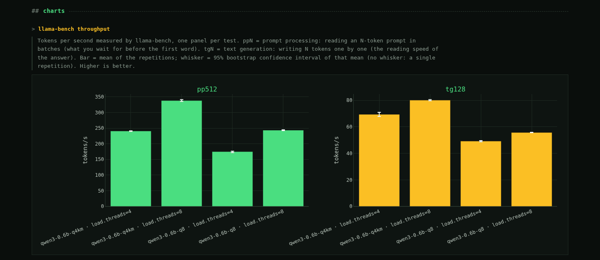
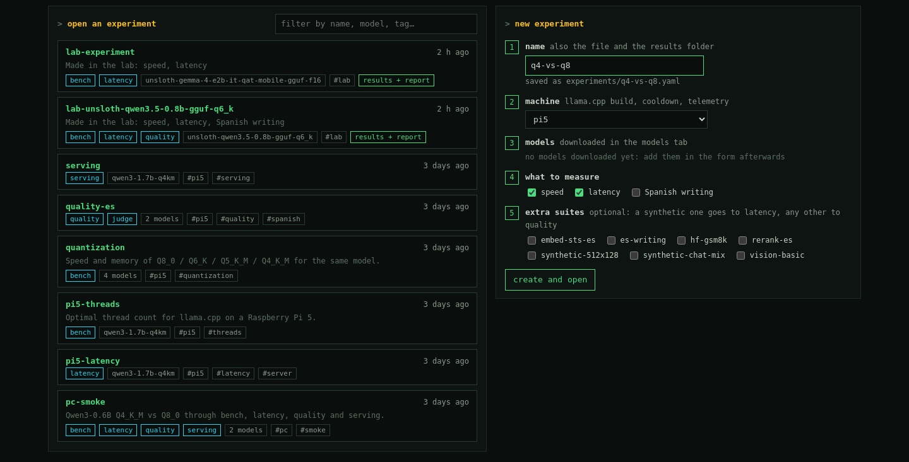
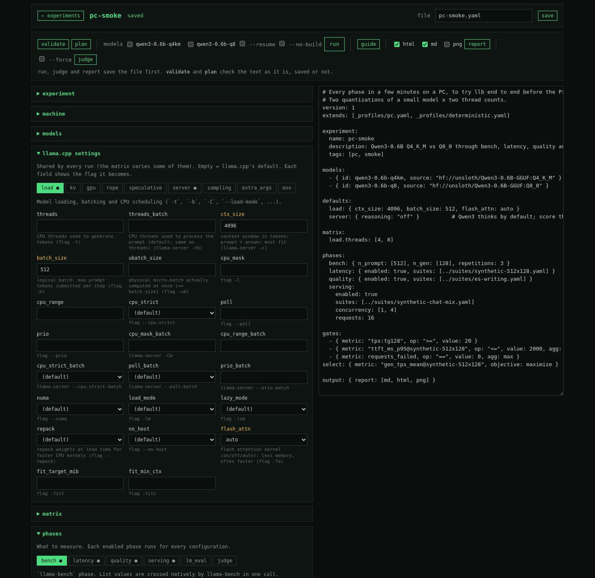
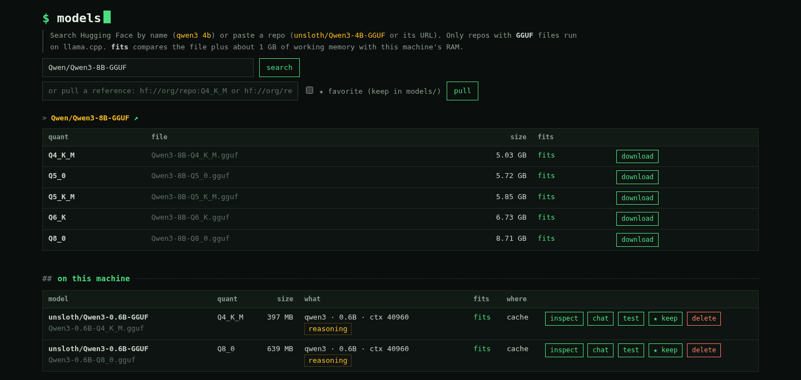
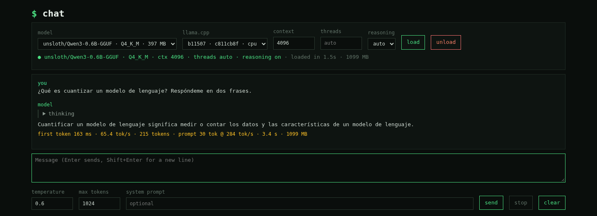
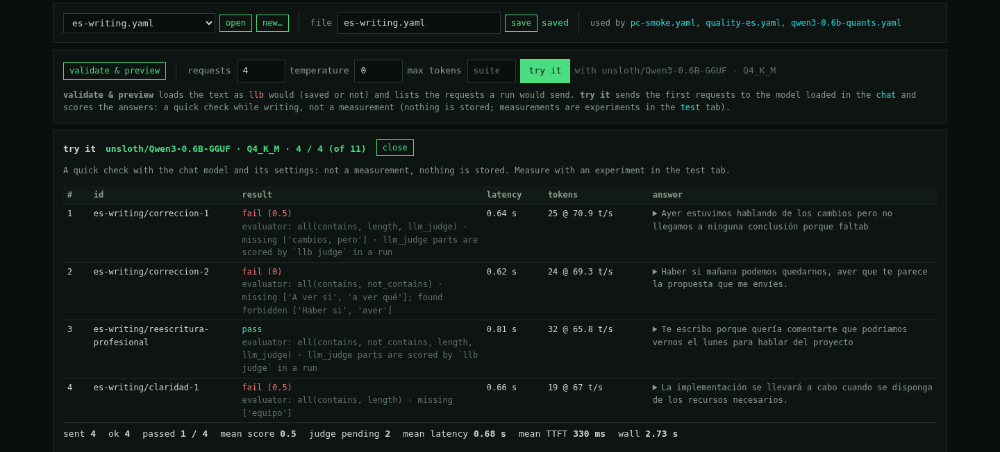
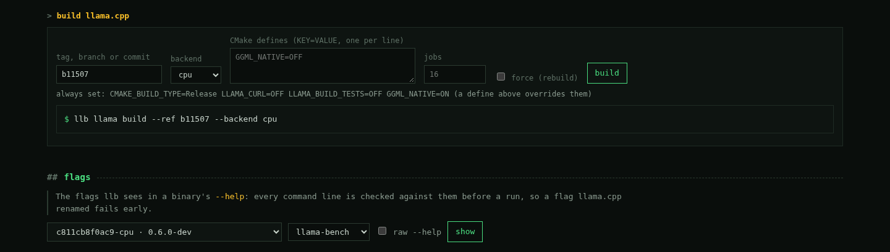

# local-llm-bench-lab

**Reproducible benchmarks for local LLMs running on [llama.cpp](https://github.com/ggml-org/llama.cpp).**

Describe an experiment in one YAML file: the models, the llama.cpp settings and the parameters to vary. The `llb` command then:

- builds llama.cpp;
- downloads the models;
- runs every combination while it watches temperature and memory;
- stores everything in SQLite;
- tells you which configuration wins, with the `llama-server` command to deploy it.

It was designed for a Raspberry Pi 5 first, and it works on any Linux PC, including WSL2.

- **Speed, latency, quality and concurrency** in one tool, driving `llama-bench`, `llama-server` and, optionally, lm-evaluation-harness.
- **Reproducible**: every result records the llama.cpp commit, the model's sha256, the exact flags and the machine. Every flag is checked against the binary before running.
- **Honest numbers**: confidence intervals per test, cooldown between runs, and noisy or throttled runs flagged as `unstable`.
- **Answers, not just tables**: pass/fail gates, a winner, HTML/Markdown reports and a web dashboard.

> Status: **v0.11.0**: every planned phase is implemented, including per-test confidence intervals and a check that serving requests fit each llama-server slot. 1.0.0 will follow validation on a Raspberry Pi 5. See [CHANGELOG](CHANGELOG.md).

## How it works


You write the YAML. `llb` compiles the llama.cpp version you pinned, fetches the models and runs one measurement per configuration (build × model × variant), sampling the hardware as it goes. Everything lands in a single SQLite file, from which the guide, the reports and the dashboard are built.

## Quick start

### 1. Install

You need:

- Linux (x86_64 or arm64);
- [uv](https://docs.astral.sh/uv/), which installs Python 3.12 for you;
- the tools to compile llama.cpp.

```bash
sudo apt install git cmake build-essential            # llama.cpp build tools (Debian/Ubuntu/Raspberry Pi OS)
curl -LsSf https://astral.sh/uv/install.sh | sh       # if you don't have uv

git clone https://github.com/pepe-va/local-llm-bench-lab.git
cd local-llm-bench-lab
uv sync --extra report --extra serve                  # with HTML reports and the dashboard
uv run llb doctor
```

Run `llb` from the repository root. The example experiments and the `models/` folder are relative to it.

### 2. Run your first experiment

[`experiments/pc-smoke.yaml`](experiments/pc-smoke.yaml) takes a few minutes on a PC. It compares two quantizations of a small model (Qwen3-0.6B, Q4_K_M and Q8_0) at 4 and 8 threads, through every phase.

```bash
uv run llb llama build --ref b11507                   # compile llama.cpp once (a few minutes)
uv run llb plan experiments/pc-smoke.yaml             # what will run, without running it
uv run llb run experiments/pc-smoke.yaml              # models download on first use; Ctrl-C is safe
```

### 3. Look at the results

```bash
uv run llb guide experiments/pc-smoke.yaml            # gates → winner → llama-server command
uv run llb serve                                      # dashboard on http://127.0.0.1:8765
```

Reports, CSVs and the SQLite database are in `$LLB_HOME/runs/pc-smoke/` (`LLB_HOME` defaults to `~/.local/share/llmbench`).



*The dashboard comparing Qwen3-0.6B Q4_K_M and Q8_0 at 4 and 8 threads (AMD Ryzen 7 7735HS). Q4_K_M with 8 threads wins: 338 tokens/s reading the prompt, 80 tokens/s writing.*

### On a Raspberry Pi 5

The Pi experiments require the `performance` CPU governor. They refuse to start while the Pi is throttling, and they wait for it to cool down to 60 °C between runs, so use an active cooler.

```bash
echo performance | sudo tee /sys/devices/system/cpu/cpu*/cpufreq/scaling_governor
uv run llb run experiments/pi5-threads.yaml           # best thread count
uv run llb run experiments/pi5-latency.yaml           # time to first token and generation speed
```

## The lab

```bash
uv run llb lab                                        # http://127.0.0.1:8765/lab, from the repository root
```

`llb lab` does from the browser almost everything the CLI does, on the same files in `experiments/` and `suites/`:

| Tab | What you do there |
|---|---|
| **models** | Search Hugging Face, see each quantization's size and whether it fits in RAM, download, inspect, keep favorites |
| **chat** | Talk to a downloaded model, with time to first token, tokens/s, memory and temperature |
| **test** | Pick or create experiments, edit them (form or YAML) and validate, plan, run, guide, report, judge |
| **suites** | Write the tests (prompts and the checks that score answers) and **try it** on the chat model |
| **system** | Environment, disk usage, llama.cpp builds and the flags each binary accepts |
| **info** | **The full manual**: concepts, recipes, phases, writing an experiment, every command, result files, models and disk, metrics, configuration, remote access, limitations, problems |
| **results** | The dashboard (`llb serve`) |





<details>
<summary>More screenshots: models, chat, suites, system</summary>









</details>

The lab listens on 127.0.0.1 only (it has no authentication). The **info** tab explains how to reach it with an SSH tunnel or Tailscale and how to keep it running with systemd.

## Development

```bash
uv sync --extra report --extra serve --extra hf-datasets
uv run pre-commit install                              # hooks: lint + types on commit, tests on push
uv run ruff check && uv run ruff format --check
uv run basedpyright
uv run pytest --cov                                    # no network; fake llama.cpp binaries
```

[CI](.github/workflows/ci.yml) runs the same hooks on every push and pull request, and the tests on x86_64 and arm64. Pushing a `vX.Y.Z` tag runs every check again and, if they pass, [publishes the GitHub Release](.github/workflows/release.yml), using the CHANGELOG section as notes.

Read [AGENTS.md](AGENTS.md) before contributing. Commits follow [Conventional Commits](https://www.conventionalcommits.org/) and releases follow [SemVer](https://semver.org/).

## License

MIT.
