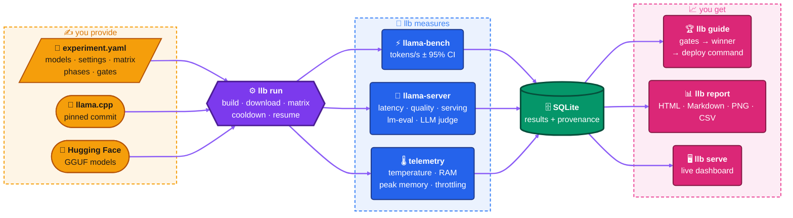

# local-llm-bench-lab

**Reproducible benchmarks for local LLMs running on [llama.cpp](https://github.com/ggml-org/llama.cpp).**

Describe an experiment in one YAML file: the models, the llama.cpp settings and the parameters to vary. The `llb` command then:

- builds llama.cpp;
- downloads the models;
- runs every combination while it watches temperature and memory;
- stores everything in SQLite;
- tells you which configuration wins, with the `llama-server` command to deploy it.

It was designed for a Raspberry Pi 5 first, and it works on any Linux PC, including WSL2.

- **Speed, latency, quality and concurrency** in one tool, driving `llama-bench`, `llama-server` and, optionally, lm-evaluation-harness.
- **Reproducible**: every result records the llama.cpp commit, the model's sha256, the exact flags and the machine. Every flag is checked against the binary before running.
- **Honest numbers**: confidence intervals per test, cooldown between runs, and noisy or throttled runs flagged as `unstable`.
- **Answers, not just tables**: pass/fail gates, a winner, HTML/Markdown reports and a web dashboard.

> Status: **v0.11.0**: every planned phase is implemented, including per-test confidence intervals and a check that serving requests fit each llama-server slot. 1.0.0 will follow validation on a Raspberry Pi 5. See [CHANGELOG](CHANGELOG.md).

## Contents

- [How it works](#how-it-works)
- [Quick start](#quick-start)
  - [1. Install](#1-install)
  - [2. Run your first experiment](#2-run-your-first-experiment)
  - [3. Look at the results](#3-look-at-the-results)
  - [On a Raspberry Pi 5](#on-a-raspberry-pi-5)
- [Going further](#going-further)
  - [What it measures](#what-it-measures)
  - [Example experiments](#example-experiments)
  - [Writing your own experiment](#writing-your-own-experiment)
  - [Commands](#commands)
  - [Results and resuming](#results-and-resuming)
  - [Models and disk space](#models-and-disk-space)
  - [Configuration](#configuration)
  - [Limitations](#limitations)
- [Development](#development)
- [License](#license)

## How it works



You write the YAML. `llb` compiles the llama.cpp version you pinned, fetches the models and runs one measurement per configuration (build × model × variant), sampling the hardware as it goes. Everything lands in a single SQLite file, from which the guide, the reports and the dashboard are built.

## Quick start

### 1. Install

You need:

- Linux (x86_64 or arm64);
- [uv](https://docs.astral.sh/uv/), which installs Python 3.12 for you;
- the tools to compile llama.cpp.

```bash
sudo apt install git cmake build-essential            # llama.cpp build tools (Debian/Ubuntu/Raspberry Pi OS)
curl -LsSf https://astral.sh/uv/install.sh | sh       # if you don't have uv

git clone https://github.com/pepe-va/local-llm-bench-lab.git
cd local-llm-bench-lab
uv sync --extra report --extra serve                  # with HTML reports and the dashboard
uv run llb doctor
```

Run `llb` from the repository root. The example experiments and the `models/` folder are relative to it.

### 2. Run your first experiment

[`experiments/pc-smoke.yaml`](experiments/pc-smoke.yaml) takes a few minutes on a PC. It compares two quantizations of a small model (Qwen3-0.6B, Q4_K_M and Q8_0) at 4 and 8 threads, through every phase.

```bash
uv run llb llama build --ref b11507                   # compile llama.cpp once (a few minutes)
uv run llb plan experiments/pc-smoke.yaml             # what will run, without running it
uv run llb run experiments/pc-smoke.yaml              # models download on first use; Ctrl-C is safe
```

### 3. Look at the results

```bash
uv run llb guide experiments/pc-smoke.yaml            # gates → winner → llama-server command
uv run llb serve                                      # dashboard on http://127.0.0.1:8765
```

Reports, CSVs and the SQLite database are in `~/.local/share/llmbench/runs/pc-smoke/`.

### On a Raspberry Pi 5

The Pi experiments require the `performance` CPU governor. They refuse to start while the Pi is throttling, and they wait for it to cool down to 60 °C between runs, so use an active cooler.

```bash
echo performance | sudo tee /sys/devices/system/cpu/cpu*/cpufreq/scaling_governor
uv run llb run experiments/pi5-threads.yaml           # best thread count
uv run llb run experiments/pi5-latency.yaml           # time to first token and generation speed
```

## Going further

### What it measures

An experiment enables one or more phases:

| Phase | Runs on | Measures |
|---|---|---|
| `bench` | `llama-bench` | Prompt and generation tokens/s per test (`pp512`, `tg128`…), with median, IQR, CV and a 95% CI |
| `latency` | `llama-server` | Time to first token, inter-token latency, end-to-end latency, one request at a time |
| `quality` | `llama-server` | A score per answer from deterministic evaluators (exact, contains, regex, numeric, length, JSON schema…). It also covers embeddings, reranking and vision. |
| `serving` | `llama-server` | Concurrent clients: requests/s, aggregate tokens/s, p95 latencies, errors |
| `lm_eval` | lm-evaluation-harness | Standard benchmarks such as GSM8K (extra `lm-eval`) |
| `judge` | `llama-server` | A stronger LLM scores answers from 1 to 5, stored apart from the objective scores |

During every run, llb also records CPU temperature, frequency, RAM, the peak memory of the llama.cpp process and, on a Pi, throttling.

### Example experiments

| File | Question |
|---|---|
| [`pc-smoke.yaml`](experiments/pc-smoke.yaml) | Does everything work? (PC, all phases) |
| [`pi5-threads.yaml`](experiments/pi5-threads.yaml) | How many threads give the best throughput? |
| [`quantization.yaml`](experiments/quantization.yaml) | Q8_0 vs Q6_K vs Q5_K_M vs Q4_K_M: speed and memory |
| [`kv-cache.yaml`](experiments/kv-cache.yaml) | What does quantizing the KV cache cost or save? |
| [`pi5-latency.yaml`](experiments/pi5-latency.yaml) | Is it fast enough for an interactive assistant? |
| [`serving.yaml`](experiments/serving.yaml) | What happens with 1, 2, 4 and 8 concurrent users? |
| [`quality-es.yaml`](experiments/quality-es.yaml) | Which model writes Spanish best? (with an LLM judge) |
| [`modalities.yaml`](experiments/modalities.yaml) | Embeddings, reranking and vision models |

### Writing your own experiment

```yaml
version: 1
extends: [_profiles/pc.yaml]                # build + hardware settings (or _profiles/pi5.yaml)

experiment:
  name: laptop-threads                      # also the results folder name

models:
  - { id: qwen3-1.7b, source: "hf://unsloth/Qwen3-1.7B-GGUF:Q4_K_M" }

defaults:                                   # llama.cpp settings shared by every run
  load: { ctx_size: 4096, batch_size: 512, flash_attn: auto }

matrix:                                     # what varies: axes are crossed
  load.threads: [2, 4, 6, 8]
  zip:                                      # these move together: f16/f16, then q8_0/q8_0
    - kv.cache_type_k: [f16, q8_0]
      kv.cache_type_v: [f16, q8_0]

phases:
  bench: { n_prompt: [512], n_gen: [128], repetitions: 5 }
  latency: { enabled: true, suites: [../suites/synthetic-512x128.yaml] }

gates:                                      # pass/fail per configuration
  - { metric: "tps:tg128", op: ">=", value: 10 }
  - { metric: "ttft_ms_p95@synthetic-512x128", op: "<=", value: 2000, agg: max }
select: { metric: "tps:tg128", objective: maximize }
```

Run `llb validate <yaml>` after each change: it points at the exact field that is wrong. Some notes:

- **Settings**: the groups under `defaults` mirror llama.cpp's options: `load`, `kv`, `gpu`, `rope`, `speculative`, `server`, `sampling`. Raw flags go in `extra_args` and environment variables in `env`. Every field is defined in [`src/llmbench/config/llama/`](src/llmbench/config/llama/). A field a tool doesn't support is reported as `ignored` (for example, `llama-bench` has no `ctx_size`).
- **Matrix**: `exclude` removes combinations and `include` adds them. Every model and build is crossed with every variant.
- **Models**: `source` can take three forms:
  - `hf://org/repo:QUANT`, optionally pinned with `@<commit>` after the repo;
  - `hf://org/repo/path/file.gguf`;
  - a local `.gguf`.

  `retention: keep` or `delete_after_run` on a model overrides the machine's `hardware.model_retention` (see [Models and disk space](#models-and-disk-space)). For gated repos, set `HF_TOKEN`.
- **Builds**: `llama_cpp.builds` takes either `{ id, ref, backend }`, which llb compiles and caches (`cpu`, `cuda`, `vulkan`, `metal`, `blas`), or `{ id, bin_dir }` to use binaries you already have. With several builds you can compare llama.cpp versions.
- **Suites**: the requests for the server phases live in [`suites/`](suites/). There are synthetic prompts with exact token counts, Spanish writing tasks, GSM8K from Hugging Face, embeddings, reranking and vision. A suite can also read jsonl/csv/parquet files or a Hugging Face dataset.
- **Gate metrics**:
  - `tps:<test>` and `tps_ci_low:<test>`;
  - any server metric (`ttft_ms_p95`, `gen_tps_mean`, `score_mean`, `error_rate`…), optionally restricted to one suite with `@<suite>`;
  - `peak_rss_mb`, `temp_peak_c` and `throttled`.
- **Variables**: `${env:VAR:-default}` reads an environment variable. The profiles use it for `LLB_LLAMA_REF`, the llama.cpp version.

### Commands

| Command | What it does |
|---|---|
| `llb validate <yaml>` | Checks the schema, the suites, the models and the flags against each build |
| `llb plan <yaml>` | Shows what `run` would execute |
| `llb run <yaml> [--resume] [-m <model>] [-y]` | Runs the experiment. Exits with 1 if a run failed and 130 if interrupted. |
| `llb report <yaml> [-f html -f md -f png]` | Builds reports from stored results |
| `llb guide <yaml>` | Applies the gates, picks the winner and writes `guidance.md`. Exits with 1 if nothing passes. |
| `llb judge <yaml>` | Runs the LLM judge over pending answers |
| `llb serve` | Starts the read-only web dashboard: compare experiments, see each one's plan, hardware, explained charts and runs, sort and filter every table |
| `llb llama build --ref <tag> [--backend cuda]` / `llama ls` | Compiles llama.cpp and lists the builds |
| `llb models pull\|ls\|inspect\|favorite\|unfavorite\|prune` | Manages GGUF models |
| `llb doctor` | Shows the environment |

Every command has `--help`.

### Results and resuming

Each experiment writes to `~/.local/share/llmbench/runs/<name>/`, or to `output.directory` if you set it:

| File | Contents |
|---|---|
| `benchmark.sqlite` | All results |
| `summary.csv` | llama-bench results |
| `latency.csv`, `quality.csv`, `serving.csv` | Server-phase results |
| `runs.jsonl` | Every run with its full configuration and requests |
| `report.*` | Reports |
| `guidance.md` | Gates, winner and deploy command |

A failed run never stops the experiment: its error is stored and the rest continue. `--resume` skips every run whose fingerprint already completed. The fingerprint is a hash of everything that determines the measurement, so changing a setting measures the affected runs again.

### Models and disk space

- Downloaded models live in the Hugging Face cache (`HF_HOME`).
- Favorites live in `models/` as real files that are never deleted automatically, and you can drop your own `.gguf` files there too.
- A model is looked up in `models/` first, then in the cache, and is downloaded only if it's in neither.
- `hardware.model_retention` says whether downloaded models stay in the cache. The `pc` profile keeps them, so repeating an experiment or `--resume` downloads nothing. The `pi5` profile uses `delete_after_run`: each model leaves the cache after its last run, so a Pi holds about one model at a time. A model can set its own `retention` to override it.

```bash
uv run llb models pull hf://unsloth/Qwen3-1.7B-GGUF:Q4_K_M --favorite
uv run llb models inspect hf://unsloth/Qwen3-1.7B-GGUF:Q4_K_M    # GGUF metadata, never downloads
uv run llb models prune --older-than 30 --dry-run                # free cache space
```

### Configuration

| Variable | Default | Purpose |
|---|---|---|
| `LLB_HOME` | `~/.local/share/llmbench` | Builds, llama.cpp source and results |
| `LLB_MODELS_DIR` | `./models` | Favorites folder |
| `LLB_LLAMA_REF` | Set by each profile | llama.cpp version used by the profiles |
| `HF_HOME`, `HF_TOKEN` | Hugging Face defaults | Model cache and access to gated repos |

Optional extras for `uv sync`:

| Extra | Enables |
|---|---|
| `report` | HTML and PNG reports |
| `serve` | The dashboard |
| `hf-datasets` | Suites built from Hugging Face datasets or parquet files |
| `lm-eval` | The `lm_eval` phase |

`uv sync` removes any extra you don't list, so repeat all of them every time.

### Limitations

- **GPU**: llb builds llama.cpp with CUDA, Vulkan or Metal and passes every offloading flag, but it doesn't read GPU telemetry: no VRAM, utilization, temperature or power. GPU builds are not tested on real hardware yet.
- **Memory**: nothing checks in advance whether a model fits in RAM. A run killed for lack of memory is recorded as failed, and the experiment continues.
- **Scope**: llama.cpp on Linux only. macOS is untested, and there is no Ollama, vLLM, cloud APIs or energy measurement.

## Development

```bash
uv sync --extra report --extra serve --extra hf-datasets
uv run pre-commit install                              # hooks: lint + types on commit, tests on push
uv run ruff check && uv run ruff format --check
uv run basedpyright
uv run pytest --cov                                    # no network; fake llama.cpp binaries
```

[CI](.github/workflows/ci.yml) runs the same hooks on every push and pull request, and the tests on x86_64 and arm64. Pushing a `vX.Y.Z` tag runs every check again and, if they pass, [publishes the GitHub Release](.github/workflows/release.yml), using the CHANGELOG section as notes.

Read [AGENTS.md](AGENTS.md) before contributing. Commits follow [Conventional Commits](https://www.conventionalcommits.org/) and releases follow [SemVer](https://semver.org/).

## License

MIT.
